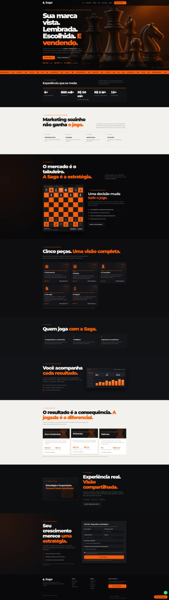

# Referência — Nova LP (base "Saga")

> Imagem: `referencia-lp-saga.webp` (564 × 2000 px, captura de página inteira, reduzida).
> **Atenção:** pela resolução baixa, títulos, números e rótulos foram transcritos com segurança, mas os textos de apoio (parágrafos, eyebrows pequenos, descrições de cards) ficaram **ilegíveis**. Onde aparece `[ilegível]`, o texto precisa ser pedido em resolução maior ou reescrito. Trechos marcados com `(?)` são leitura provável, não confirmada.

---

## 1. Visão geral do layout de referência

- **Conceito:** xadrez como metáfora — "o mercado é o tabuleiro, a Saga é a estratégia". Peças (rei, rainha, torre, cavalo, peão) viram ícones dos 5 pilares/serviços.
- **Paleta:** preto quase puro (#0B0B0C–#151515), laranja vibrante (muito próximo do `#F35703` da Convext) e um **bege/off-white** (#F1EFEA aprox.) para seções claras que quebram o ritmo escuro.
- **Tipografia:** display geométrica, pesada (Montserrat ExtraBold/Black ou similar), tracking apertado; palavra(s) final(is) do título em laranja. Eyebrows em caixa-alta minúscula, laranja, precedidos de um traço curto (`— EYEBROW`).
- **Grid:** conteúdo centralizado em container estreito (~840 px no desktop de 1690), muito respiro lateral.
- **Ritmo de fundo:** escuro → faixa laranja (marquee) → escuro → **claro** → escuro (gradiente) → escuro → escuro → **claro** → escuro → escuro (gradiente laranja no canto) → rodapé escuro.
- **Elementos fixos:** header com CTA laranja; botão WhatsApp verde flutuante + pill laranja "Solicitar diagnóstico" no canto inferior direito.

---

## 2. Seções (de cima para baixo)

### 2.1 Header
- Logo: ícone de raio + "Saga" (itálico).
- Navegação: **Início** (ativo, laranja) · Método Saga · Soluções · Cases · Quem somos · Saga OS
- CTA: **Solicitar diagnóstico ↗** (botão laranja).

### 2.2 Hero (fundo escuro + foto de peças de xadrez com luz laranja à direita)
- Eyebrow: `— ASSESSORIA E CONSULTORIA DE MARKETING E COMERCIAL PARA O MERCADO IMOBILIÁRIO` (?)
- **H1:** "Sua marca vista. Lembrada. Escolhida. **E vendendo.**" (uma frase por linha; "E vendendo." em laranja)
- Parágrafo: "Toda grande marca tem uma história. **A nossa é acelerar a sua.** A Saga conecta marca, conteúdo, mídia e operação comercial [ilegível]…"
- CTAs: **[primário laranja] Agendar conversa ↗ (?)** · **[secundário outline] Conhecer o Método Saga →**
- Prova social inline: **800 MIL+** leads (?) · **R$ 5 BI+** VGV (?) · **6+ ANOS** de consultoria (?)
- Crédito discreto no canto inferior direito da imagem: `SAGA / [ilegível]`.

### 2.3 Marquee (faixa laranja, texto preto, separador = ícone de peça)
`POSICIONAMENTO · CONTEÚDO · TRÁFEGO · CRM · ATENDIMENTO · VENDAS · POSICIONAMENTO · CONTEÚDO · …`

### 2.4 Números (fundo escuro)
- Eyebrow: `— A SAGA EM NÚMEROS`
- **H2:** "Experiência que se mede."
- Texto lateral à direita: [ilegível]
- 5 cards em linha com borda superior laranja e rótulo pequeno acima do número:

| Número | Legenda |
|---|---|
| **6+** | anos de experiência |
| **800 mil+** | leads gerados (?) |
| **R$ 50 mi+** | investidos em mídia (?) |
| **R$ 5 bi+** | em VGV [ilegível] (?) |
| **15+** | colaboradores (?) |

### 2.5 Problema (fundo **claro**)
- Eyebrow: `— O PROBLEMA NÃO É FALTA DE MARKETING` (?)
- **H2:** "Marketing sozinho não ganha **o jogo.**"
- Texto à direita: "Campanhas podem gerar volume, mas negócios precisam de um sistema. Quando [ilegível]…"
- 4 cards (rótulo laranja "01 / [ilegível]" acima do título):
  1. **Posicionamento** — [ilegível]
  2. **Conteúdo** — [ilegível]
  3. **Performance** — [ilegível]
  4. **Comercial** — [ilegível]

### 2.6 Método (fundo escuro com leve gradiente)
- Eyebrow: `— O MÉTODO SAGA`
- **H2:** "O mercado é o tabuleiro. **A Saga é a estratégia.**"
- Texto lateral à direita: "Cada peça representa uma competência. Juntas, [ilegível]… vantagem competitiva." (?)
- **Componente interativo:** tabuleiro de xadrez laranja/preto com peças nas posições iniciais; header do card "MÉTODO SAGA · [ilegível]" e rodapé com legenda "Jogada nº 1 (?)" + botões "Reproduzir ▶ (?)" e "↺ Reiniciar (?)" — sugere uma animação de partida.
- Bloco ao lado do tabuleiro:
  - Eyebrow: `— O TABULEIRO EM MOVIMENTO` (?)
  - **H3:** "Uma decisão muda **todo o jogo.**"
  - Parágrafo [ilegível]
  - Lista com 4 itens numerados em laranja (01–04): [ilegível]
  - Botão outline: "Explorar as cinco estratégias →" (?)

### 2.7 Cinco peças / pilares (fundo escuro)
- Eyebrow: `— CADA PEÇA É UMA ESTRATÉGIA` (?)
- **H2:** "Cinco peças. **Uma visão completa.**"
- Subtítulo: "Clique em uma peça para abrir a explicação detalhada [ilegível]…"
- 5 cards (3 + 2) com ícone de peça laranja, número "01 / 05" no canto, categoria em laranja, título, descrição e dois links ("Saiba mais →" laranja · "Solicitar diagnóstico ↗"):

| Peça | Título | Categoria (aprox.) |
|---|---|---|
| Rei | **O Movimento** | RE / Gestão completa de marketing e comercial (?) |
| Rainha | **A Escala** | RAINHA / Base e código [ilegível] (?) |
| Torre | **A Conquista** | TORRE / Tecnologia comercial, CRM e atendimento (?) |
| Cavalo | **A Jornada** | CAVALO / Tráfego pago e [ilegível] (?) |
| Peão | **A Origem** | PEÃO / Posicionamento, conteúdo e identidade (?) |

- Nota de rodapé pequena abaixo dos cards: [ilegível]

### 2.8 Para quem (fundo escuro)
- Eyebrow: `— PARA QUEM`
- **H2:** "Quem joga **com a Saga.**"
- 3 cards numerados:
  1. **Incorporadoras e construtoras** — [ilegível]
  2. **Imobiliárias** — [ilegível]
  3. **Empresas do ecossistema** — [ilegível]

### 2.9 Portal do cliente / Saga OS (fundo escuro)
- Eyebrow: `— SAGA OS / PORTAL DO CLIENTE`
- **H2:** "Você acompanha **cada resultado.**"
- Parágrafo: "O Saga OS é o portal onde o cliente acompanha o que a Saga [ilegível]…"
- 3 bullets com marcador laranja: [ilegível]
- Mockup de dashboard à direita: sidebar, 3 KPIs (**360°** · **ON** · **DATA**) e gráfico de barras laranja crescente.

### 2.10 Cases (fundo **claro**)
- Eyebrow: `— CASES DE SUCESSO`
- **H2:** "O resultado é a consequência. **A jogada é o diferencial.**"
- Subtítulo [ilegível]
- 3 cards (topo escuro com torre laranja ao fundo, corpo branco, 2 métricas em laranja, link "Ler case completo ↗"):

| Cliente | Rótulo | Métrica 1 | Métrica 2 |
|---|---|---|---|
| **Econ Construtora** | CASE 01 / [ilegível] | 400 mil+ | R$ 1 bi+ |
| **Metrocasa** | CASE 02 / [ilegível] | 300 mil+ | R$ 1 bi+ |
| **HabCasa** | CASE 03 / [ilegível] | 70+ | R$ 50 mi+ |

- O card do meio tem borda laranja (destaque/hover).
- Disclaimer pequeno abaixo: [ilegível]

### 2.11 Quem somos (fundo escuro)
- Card à esquerda: eyebrow `— QUEM FAZ A SAGA`, frase "Estratégia é importante. **Pessoas fazem acontecer.**" sobre ícone de rei translúcido.
- Eyebrow: `— QUEM SOMOS`
- **H2:** "Experiência real. **Visão compartilhada.**"
- Parágrafo [ilegível]
- 3 chips com nomes dos sócios (?) [ilegível]
- Botão outline: "Conhecer a Saga e nossos sócios ↗" (?)

### 2.12 CTA final + formulário (fundo escuro com gradiente laranja à esquerda)
- Eyebrow: `— SUA PRÓXIMA JOGADA` (?)
- **H2:** "Seu crescimento merece **uma estratégia.**"
- Parágrafo [ilegível]
- 3 checks laranja:
  - Contato direcionado ao seu desafio (?)
  - Avaliação de prioridades, canais e indicadores (?)
  - Sem promessa de resultado sem diagnóstico (?)
- Nota pequena [ilegível]
- **Formulário "Solicitar diagnóstico estratégico"** (card escuro):
  - Nome completo* · WhatsApp com DDD*
  - E-mail profissional* · Empresa*
  - Qual desafio é prioridade?* (select)
  - Investimento mensal que pretende em marketing (opcional) (select)
  - Checkbox de consentimento LGPD
  - Botão laranja full-width: **Enviar solicitação ↗**
  - Linha final com link para Política de Privacidade

### 2.13 Rodapé (fundo escuro)
- Logo Saga + descrição curta [ilegível]
- **Explorar:** Método Saga · Soluções · Cases · Quem somos
- **Soluções:** O Movimento · A Escala · A Conquista · A Jornada · A Origem
- **Próximo movimento:** texto curto + botão laranja **Agendar diagnóstico ↗**
- Barra inferior: © [ano] Saga · Política de privacidade · [ilegível]
- Flutuantes: botão WhatsApp + "Solicitar diagnóstico ↗".

---

## 3. Comparação com a home atual da Convext (`app/(marketing)/page.tsx`)

Ordem atual: `Hero` (com `HeroLeadForm`) → `Manifesto` (pinado, laranja) → `Marquee` → `ValueProposition` (+ `EquationReveal`) → `Services` (5 serviços, pinado com scramble) → `Metrics` (4 números) → `Projects` (cases do Supabase + diagnóstico) → `MainCta` → `FloatingCta`. Layout de marketing adiciona `Header`, `Footer` laranja com wordmark gigante, `SmoothScroll` (Lenis), `Cursor`, `PointerSpotlight` e `RouteCurtain`.

| Referência Saga | Equivalente atual | O que muda |
|---|---|---|
| Hero com foto + 2 CTAs + prova inline | `Hero` + `HeroGlow` + formulário à direita | Formulário sai do hero e vai para o fim; entra imagem/arte de xadrez |
| Marquee laranja | `Marquee` (fundo escuro, texto grande) | Faixa fina com fundo laranja e ícone de peça como separador |
| Experiência que se mede (5 números) | `Metrics` (4 números, `siteConfig.metrics`) | Sobe para logo depois do hero; vira 5 itens |
| Marketing sozinho não ganha o jogo (4 cards, fundo claro) | `ValueProposition` (parcial) | Seção nova; introduz o fundo claro (não existe token hoje) |
| Método Saga + tabuleiro interativo | — | Componente novo (tabuleiro animado) |
| Cinco peças | `Services` (5 itens de `siteConfig.services`) | Mesma quantidade de itens; vira grade de cards com ícones de peça |
| Quem joga com a Saga | Texto dentro de `Metrics` | Seção nova com 3 públicos |
| Saga OS / portal | — | Seção nova (dá para mostrar o dashboard real do Convext) |
| Cases (3 cards claros) | `Projects` + `CaseRail` (Supabase) | Reaproveitar dados de `listPublishedCases`; novo visual do card com métricas |
| Quem somos | `Manifesto` (parcial) | Seção nova com sócios |
| CTA final + formulário completo | `MainCta` + `HeroLeadForm` | Fundir: CTA com formulário ampliado (desafio, investimento, LGPD) |
| Rodapé escuro em 4 colunas | `Footer` laranja com wordmark | Mudança visual grande |

**Reaproveitável sem esforço:** tokens de cor (laranja já bate), `Container`, `SplitLines`, `FadeUp`, `Magnetic`, `RollLabel`, `Marquee` (com troca de estilo), `CaseRail`, `listPublishedCases`, `/api/contact` (precisa aceitar os campos novos), `FloatingCta`.

**Precisa decidir antes de implementar:**
1. Marca: a LP nova é para **Saga** (domínio `sagacompanybr.com.br`, já em `siteConfig.contact.email`) ou é só referência visual para a Convext?
2. Fonte display: manter Archivo ou trocar por uma geométrica tipo Montserrat?
3. Textos de apoio ilegíveis: pedir a referência em resolução maior ou escrever a copy do zero?
4. Imagem do hero (peças de xadrez) e ícones das peças: temos os arquivos ou vamos gerar/comprar?
