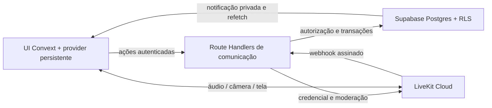

# SPEC — Salas, chamadas e apresentações da Convext

Status: proposta de implementação; não implementada. Escopo confirmado: equipe autenticada, sem convidados externos na v1. Wireframes: [comunicacao-wireframes.md](./comunicacao-wireframes.md).

## 1. Objetivo e resultado esperado

Permitir que a equipe entre em espaços de conversa, inicie chamadas individuais ou em grupo, ligue a câmera e apresente uma tela sem abandonar a operação da Convext. Navegar para Demandas ou Clientes deve manter a sessão ativa e seus controles acessíveis.

A referência é a organização funcional de comunicação do Discord: conexão compartilhada por voz/vídeo/apresentação, participantes, estados e controles. A REA anterior comprova interfaces locais dessas capacidades, mas não comprova o protocolo de salas do Discord. Esta spec define um modelo próprio para a Convext, sem depender dos binários, protocolo ou serviços do Discord.

## 2. Contexto verificado no repositório

| Existente | Consequência para implementação |
|---|---|
| Next.js 16.3.6, React 19, Tailwind, Radix/shadcn, Lucide | Reutilizar componentes e tokens; carregar SDK de mídia apenas no cliente. |
| `app/(dashboard)/app/layout.tsx` monta sidebar de 288px e header | Hospedar a sessão acima das páginas; não criar outra navegação de servidores/canais. |
| `app/(dashboard)/app/template.tsx` envolve páginas | Não guardar a conexão no template nem na página da sala. |
| `lib/access.ts`, `proxy.ts`, guards de perfil | Adicionar área `salas` às quatro roles, além de autorização específica por sala. |
| `/app/equipe` restrita a admin | Diretório mínimo de pessoas deve existir dentro de Salas, sem abrir a área administrativa. |
| `profiles.available` e `status_id` manuais | Não sobrescrever disponibilidade/status quando alguém entra ou sai de uma chamada. |
| Supabase Auth/Postgres e migrations existentes | Reutilizar identidade; adicionar RLS e registros de comunicação. |
| Scripts Next e Vinext; `wrangler.jsonc` aponta para Workers | Validar SDK de servidor no runtime efetivamente usado. Não hospedar SFU no Route Handler. |

O schema inspecionado não demonstra organizações/workspaces isolados. A v1 atende uma única equipe Convext. A abstração de multiempresa não será inventada nesta entrega.

## 3. Escopo e parâmetros iniciais

Incluso: salas persistentes abertas e privadas; chamada direta 1:1 e em grupo; microfone, câmera, apresentação, áudio da apresentação quando suportado; seleção de dispositivos; participantes e fala ativa; moderação; reconexão; sessão compacta; interface responsiva e acessível.

Fora da v1: convidados externos, gravação, transcrição, chat textual persistente, controle remoto, telefonia, agendamento, salas de audiência/stage, aplicativos nativos e criptografia ponta a ponta com gestão própria de chaves. Sala privada significa acesso restrito, não uma promessa de E2EE.

Parâmetros propostos, centralizados em configuração de servidor: 12 participantes por sessão, 6 câmeras publicadas simultaneamente, 1 apresentação por sessão; chamada tocando por 30s; reserva de entrada por 30s; tolerância de reconexão de 30s; encerrar encontro vazio após 60s. São limites de produto para validação, não capacidade comprovada do provedor. O servidor aplica cotas atomicamente; desabilitar botões sozinho não é suficiente.

## 4. Modelo de produto

| Conceito | Duração e comportamento |
|---|---|
| Sala aberta à equipe | Persistente, aparece para qualquer membro elegível, entrada livre enquanto desbloqueada. “Aberta” nunca significa pública na internet. |
| Sala privada | Persistente, aparece apenas a membros admitidos e convidados pendentes; convite deve ser aceito antes da entrada. |
| Sessão de sala | Criada na primeira entrada autorizada; no máximo uma não encerrada por sala. Termina quando encerrada pelo moderador ou após ficar vazia pelo prazo definido. |
| Chamada direta | Temporária; chamador escolhe pessoas, destinatários aceitam individualmente. Não permanece no catálogo de salas. |
| Participação | Vínculo entre pessoa, sessão e conexão ativa; inclui reserva, entrada, reconexão, saída e remoção. |
| Papel na sala | Proprietário, moderador ou membro. Separado da role global da plataforma. |

Uma chamada direta 1:1 usa o mesmo mecanismo de mídia da chamada em grupo. Ligar a câmera não cria outra sessão. Uma pessoa participa de apenas uma sessão de comunicação por vez, inclusive entre abas e dispositivos.

## 5. Permissões

Todas as quatro roles onboarded podem acessar Salas, criar salas abertas/privadas, iniciar chamadas, aceitar convites e usar mídia quando autorizadas. O criador torna-se proprietário; pode nomear moderadores. Os demais participantes são membros. Um admin global pode arquivar uma sala por gestão, com auditoria; isso não lhe concede acesso automático ao áudio nem listagem irrestrita de chamadas privadas.

| Ação | Membro | Moderador | Proprietário |
|---|---|---|---|
| Entrar e publicar mídia | Conforme acesso, bloqueio e cotas | Sim | Sim |
| Silenciar a si / desativar câmera | Sim | Sim | Sim |
| Ajustar volume local de outro | Sim, afeta apenas quem ajusta | Sim | Sim |
| Convidar para sala privada / alterar membros | Não | Sim, sem alterar proprietário | Sim |
| Bloquear novas entradas / remover participante | Não | Sim, exceto proprietário | Sim |
| Impedir publicação de áudio/vídeo/tela | Não | Sim, exceto proprietário | Sim |
| Encerrar sessão para todos | Não | Sim | Sim |
| Renomear, transferir propriedade, arquivar sala | Não | Não | Sim |

Nunca ativar microfone/câmera remotamente. “Permitir falar” remove uma restrição, mas a pessoa precisa ativar o próprio microfone. Remover de uma sessão bloqueia reentrada nessa sessão; revogar acesso à sala também remove a participação atual. Mudança de aberta para privada exige sessão vazia na v1, para tornar a política de transição previsível.

Permissões de sala aberta não se sobrepõem a bloqueios individuais. Dono precisa transferir propriedade ou arquivar antes de abandonar a administração. Chamada direta: iniciador modera o encontro; se sair, o papel passa ao participante conectado há mais tempo, com desempate determinístico. Em sala persistente, dono sair não encerra a sessão.

## 6. Fluxos

### F1 — Entrar em sala

1. Abrir `/app/salas`; catálogo mostra apenas salas visíveis ao usuário, contagem de participantes e acesso.
2. Selecionar sala abre pré-entrada. Não solicitar dispositivos apenas por visitar o catálogo.
3. Pré-entrada começa com mic e câmera desligados; “Testar microfone”/“Ativar câmera” solicita permissão e mostra preview estritamente local. Escolha explícita vale para aquela entrada.
4. “Entrar” valida acesso novamente, reserva vaga e obtém credencial de mídia. Ao conectar, publica apenas as fontes autorizadas e escolhidas. Pode entrar só para ouvir, sem mic/câmera disponíveis.
5. Falha de publicação mantém participante conectado como ouvinte, com erro e opção de tentar novamente. Fechar pré-entrada para todas as tracks locais.

### F2 — Sala privada e convite

Criador informa nome de 2–60 caracteres, descrição opcional até 240, acesso e convidados. A sala privada já nasce com dono como membro. Convites ficam na caixa de entrada do destinatário, expiram em 24h e podem ser revogados. Aceitar é uma transação idempotente que cria membership. Um link interno aponta para a sala, mas não concede acesso. Usuário sem acesso recebe indisponível/404 sem nome, participantes ou existência da sala.

### F3 — Chamada direta

Em Salas → Pessoas, selecionar um ou mais colegas e “Chamar”; campo de busca retorna somente id, nome, avatar e estado de comunicação. Disponibilidade manual não equivale a entrega da chamada. A chamada abre pré-entrada para o iniciador; tocar começa após ele conectar com sucesso como participante em espera. Destinatários recebem cartão “X está chamando”, participantes previstos, Aceitar/Recusar. Aceitar abre pré-entrada; o aceite não ativa câmera ou microfone.

Sem destinatários aceitos em 30s, encerrar como não atendida. Se todos recusarem, encerrar imediatamente; cancelar pelo chamador antes do primeiro aceite encerra como cancelada. Após o primeiro aceite, a sessão passa a ativa e os demais convites podem expirar sem encerrar o encontro. Aceitar perto do timeout usa compare-and-set transacional; uma chamada encerrada não pode ser reaberta. Novos convites durante encontro ativo têm seu próprio prazo. Abrir notificação em outra aba não aceita duas vezes.

Pessoa já em sessão recebe aviso discreto e pode escolher “Sair e atender”; nunca abandonar a chamada atual automaticamente. Sem app aberto, v1 não promete toque/push em segundo plano; registrar resultado não atendido e sincronizar ao reabrir.

### F4 — Vídeo e apresentação

Câmera liga/desliga na mesma sessão. Preview local pode ser espelhado; tela compartilhada nunca. Botão Apresentar chama o seletor nativo do navegador sob interação direta; não construir uma lista própria de janelas. Cancelar seletor preserva a chamada. Capturar uma fonte não implica que ela já foi publicada.

Como há uma apresentação por sessão, o cliente captura sob o clique, solicita a reserva de apresentação e publica só após aprovação; se perder a disputa, encerra imediatamente a captura local e explica “Outra pessoa começou a apresentar”. O backend concede publicação apenas ao detentor. Ao perder reserva, remover acesso, sair, receber `track.ended` ou falhar publicação, liberar reserva e interromper tracks. Reserva sem publicação expira após 15s; a concessão expirada deve ser removida também no provedor.

Uma apresentação ocupa o palco principal por padrão; participantes ficam na faixa secundária. Fixar alguém é preferência local, não altera a visão dos outros. Se uma tela já fixada pelo usuário perder a fonte, voltar à galeria. Áudio da tela e microfone são tracks distintas: mutar microfone não silencia a apresentação. Mostrar controle explícito do áudio da apresentação quando ela o possui.

### F5 — Navegação, troca e encerramento

Navegação dentro de `/app` mantém a sessão no provider persistente. Fora da tela ativa, mostrar dock com sala, duração, mic, câmera, apresentação ativa, abrir e sair. Duração é da sessão, não de cada componente.

Tentar entrar em outra sessão abre confirmação “Sair de X e entrar em Y”. A troca encerra a conexão anterior antes de publicar na nova; se a nova falhar, mostrar opção de retornar, sem reconectar silenciosamente. Outra aba/dispositivo exige tomada explícita de sessão. Logout encerra publicação local imediatamente, revoga a participação no backend e então sai da conta. Fechar aba não depende de `beforeunload` para liberar presença.

“Sair” afeta somente o usuário. “Encerrar para todos” exige confirmação, encerra o provedor e bloqueia credenciais novas para a sessão. Arquivar sala encerra encontro ativo com a mesma confirmação; mantém histórico de metadados conforme retenção.

## 7. Estados e sincronização

Conexão cliente: `idle → prejoin → joining → connected → reconnecting → connected` ou `failed/ended`. `leaving` pode partir de qualquer estado com recursos alocados; seu cleanup é idempotente. Não confundir conectado ao WebSocket com áudio reproduzível.

Sessão: `waiting` (chamada direta aguardando aceite), `active`, `ending`, `ended`. Sala usa sessão `active` desde a primeira entrada confirmada. Aceites pendentes são dados próprios de convite. `ending/ended` são monotônicos: webhook atrasado não reabre encontro.

Fontes locais: `off`, `requesting`, `on`, `denied`, `unavailable`, `failed`; tela também `selecting`. “Silenciado pelo moderador” é restrição independente do mute escolhido pela pessoa. Reconexão preserva mute e nunca republica câmera/tela que estavam desligadas. Depois do limite de 30s, oferecer “Reconectar” e “Sair”; revalidar acesso e reservas.

Autoridades: Postgres decide autorização, convites, sessão e reservas; SFU decide conexões/tracks efetivas; eventos SDK atualizam a interface; webhooks reconciliam registros. Presence do frontend e `profiles.available` não autorizam entrada nem provam participação. Indicador “Em chamada” é derivado da participação confirmada e não revela sala privada a terceiros.

## 8. Arquitetura recomendada

Proposta: LiveKit Cloud para SFU, sinalização e conectividade de mídia; Supabase para identidade, dados e notificações; UI Convext com `livekit-client` e integração React sem importar um tema/layout pronto. Aprovar custos, região, limites e compatibilidade em spike antes de contratar produção. Alternativas consideradas: SFU próprio aumenta operação; mesh P2P exige upload multiplicado por destinatário e complica grupos. O custo de operação favorece começar gerenciado.



Nenhum áudio/vídeo passa pelo Postgres, Storage ou Route Handler. A aplicação controla a autorização e a apresentação da UI; o SDK controla negociação, transporte e reconexão. A arquitetura de rooms/participants/tracks é documentada pelo [LiveKit](https://docs.livekit.io/intro/basics/rooms-participants-tracks/).

Module `communication` concentra entrada, saída, credenciais, fontes, exclusão de sessões simultâneas e cleanup. Interface do cliente: estado observável + `join`, `leave`, `setMicrophone`, `setCamera`, `startPresentation`, `stopPresentation`, `selectDevice`. Políticas são calculadas no servidor; telas não montam JWT nem conhecem segredos. SDK pode ficar em implementação interna; não criar abstração genérica para vários fornecedores antes de existir uma segunda integração.

## 9. Modelo de dados proposto

Nomes abaixo são novos; não reutilizar `clients` como membros nem o Status de Demanda para estados de chamada. IDs UUID, timestamps do servidor, índices em FKs e predicados de RLS.

| Tabela | Campos principais e restrições |
|---|---|
| `communication_rooms` | id, name, description, access(open/private), owner_id, locked_at, archived_at, version, created_at; dono elegível. |
| `communication_room_members` | room_id, user_id, role(owner/moderator/member), joined_at; unique(room_id,user_id), um owner coerente com sala. |
| `communication_room_invites` | id, room_id, inviter_id, invitee_id, state, expires_at, responded_at; um pendente por destinatário/sala. |
| `communication_sessions` | id, room_id nullable, kind(room/direct), initiator_id, moderator_id para direct, provider_room_name opaco único, state, started_at, ended_at, version; unique parcial room_id enquanto não encerrada. |
| `communication_call_invites` | id, session_id, inviter_id, invitee_id, state(ringing/accepted/declined/expired/cancelled), expires_at, responded_at; aceite não equivale a presença conectada. |
| `communication_participations` | id, session_id, user_id, connection_id, generation, state(reserved/joined/reconnecting/left/removed), reserved_until, joined_at, left_at, leave_reason; guarda tentativas distintas sem apagar histórico. |
| `communication_user_leases` | user_id PK, participation_id, generation, expires_at; trava de sessão única por pessoa entre abas/dispositivos. |
| `communication_media_leases` | session_id, source(camera/screen), slot, participation_id, expires_at, state; uma vaga screen e seis camera configuráveis. |
| `communication_session_restrictions` | session_id,user_id,removed,deny_mic,deny_camera,deny_screen,actor_id,version; impede reentrada/publicação indevida. |
| `communication_events` | id, session_id nullable, room_id nullable, actor_id nullable, event_type, minimal_payload, created_at; auditoria de moderação/encerramento. |
| `communication_provider_events` | event_id único, type, received_at, processed_at, outcome; deduplicação de webhook sem guardar tokens ou mídia. |
| `communication_notifications` | id, recipient_id, kind, reference_id, read_at, created_at; caixa de entrada individual. |
| `communication_outbox` | id, operation_id único, operation, target_id, state, attempts, next_attempt_at; recuperação de comandos ao provedor. |

Transações/RPCs específicas reservam entrada, aceite, cotas e mudanças de moderação; escritas arbitrárias pelo browser são negadas. `communication_sessions.kind=room` exige room_id; `direct` exige room_id nulo. Não persistir speaking/volume a cada frame. Preferências de dispositivo podem ser locais, nunca incluindo credenciais.

Retenção proposta: metadados de encontros e auditoria por 30 dias; deduplicação de webhook por 7 dias, sujeito ao horizonte real de retry validado no spike. Limpeza idempotente e horários do servidor. Não excluir sala referenciada para simular arquivamento.

## 10. Autorização, credenciais e consistência

RLS em todas as tabelas expostas. Usuário onboarded lê salas abertas, próprias privadas e convites dirigidos a ele. Participantes veem metadados de sua sessão; terceiros veem somente agregados autorizados. Diretório mínimo é um endpoint restrito, sem conceder SELECT irrestrito de perfis/e-mails/telefones.

Toda mutação valida sessão Supabase no servidor, perfil atual e autorização do objeto. Não confiar em `user_id`, role ou permissions vindos do body nem em user_metadata. Escritas de lifecycle só por operações de backend bem definidas. Funções privilegiadas, se necessárias, ficam em schema não exposto com grants mínimos, `search_path` fixo e checagem de identidade. Testar acesso direto pela Data API, não apenas rotas.

JWT de mídia nasce no backend, para uma sessão/identidade/generation e grants mínimos; TTL proposto de 60s para ingresso, `Cache-Control: no-store`; segredo nunca `NEXT_PUBLIC_`, URL, logs ou armazenamento persistente do browser. Expiração de token não desconecta uma sessão já ativa. Câmera/tela só recebem grants após reserva; remover track sem remover grant não aplica cota. Validar fontes permitidas e bloqueio de múltiplas publicações no spike.

Revogação requer gravar restrição, impedir nova emissão e aplicar remoção/revogação no provedor. LiveKit documenta revogação no Cloud e diferenças no self-hosted; token curto sozinho não substitui revogação de sessão. [Tokens e grants](https://docs.livekit.io/frontends/reference/tokens-grants/).

Reservar vagas e sessão única em transação com locks/constraints. Estado reservado não conta como conectado; expira em 30s. Renovações de lease verificam geração atual e presença no provedor, não apenas heartbeat do browser. Antes de tomar lease expirada, confirmar ou remover conexão anterior; nunca conceder duas publicações com gerações diferentes. BroadcastChannel otimiza abas, mas a trava do servidor é autoridade.

Postgres e provedor não compartilham transação: registrar intenção + outbox, executar comando idempotente, confirmar resultado. Em falha, mostrar “Aplicando restrição” e repetir com limite/backoff; não mostrar “Removido” enquanto conexão ainda existe. Sessões terminando recusam novas entradas. Worker/agendamento de reconciliação verifica pendências e conexões a cada 30s; mecanismo precisa existir no deploy antes de liberar a feature. Não depender de promise solta após a resposta HTTP.

Webhook valida assinatura sobre body bruto; deduplica event_id; compara sessão, identidade e generation; nunca decrementa contagem cegamente. Processamento tolera atraso, repetição e perda, reconsultando provedor quando há divergência. Eventos assinados de track indevida geram remoção, mas não são o único mecanismo preventivo. [Webhooks LiveKit](https://docs.livekit.io/intro/basics/rooms-participants-tracks/webhooks-events/).

Notificações Realtime usam tópicos privados por destinatário ou sala autorizada e payload mínimo de invalidação; refetch autenticado obtém conteúdo. Reavaliar assinaturas quando acesso muda; não continuar transmitindo dados privados a um tópico com assinantes revogados. [Autorização Realtime](https://supabase.com/docs/guides/realtime/authorization).

## 11. Contratos HTTP propostos

Base `/api/communication`. Ações autenticadas usam cookies/sessão existentes, validação Zod, proteção de origem/CSRF adequada, limites de frequência e respostas no-store. `Idempotency-Key` obrigatório em create/join/call/accept; chave vinculada a usuário, operação e hash do body. Reutilização com outro body retorna 409.

| Método / caminho | Entrada e resultado |
|---|---|
| GET `/rooms` | Busca/cursor; somente salas visíveis + contagens autorizadas. |
| POST `/rooms` | name, description, access, inviteeIds; retorna room. |
| GET/PATCH `/rooms/:id` | Detalhe ou mudança autorizada com expectedVersion. |
| POST `/rooms/:id/archive` | Confirmação e versão; encerra encontro ativo e arquiva. |
| POST `/rooms/:id/invites` | inviteeIds; convites idempotentes. |
| POST `/room-invites/:id/respond` | accept/decline; valida destinatário e validade. |
| DELETE `/rooms/:id/members/:userId` | Revoga acesso e participação atual. |
| PATCH `/rooms/:id/members/:userId` | role; apenas proprietário administra moderadores. |
| POST `/rooms/:id/transfer` | newOwnerId já membro; transferência atômica. |
| GET `/people` | Diretório mínimo paginado, sem dados administrativos. |
| POST `/calls` | inviteeIds; cria chamada esperando conexão do iniciador; convites só tocam após conexão. |
| POST `/calls/:id/invite` | Novos destinatários, respeitando capacidade e acesso. |
| POST `/call-invites/:id/respond` | accept/decline; transição atômica contra timeout. |
| POST `/calls/:id/cancel` | Apenas iniciador antes do primeiro aceite. |
| POST `/join` | roomId OU sessionId, deviceSessionId, operationId; reserva + serverUrl, token, sessionId, participationId, generation, capabilities, expiresAt. |
| POST `/sessions/:id/leave` | participationId e generation; idempotente. |
| POST `/sessions/:id/renew` | Renova participação/credencial após validar geração, acesso e estado. |
| POST `/sessions/:id/takeover` | Confirmação explícita; revoga conexão anterior antes de admitir nova. |
| POST/DELETE `/sessions/:id/publications/:source` | Reserva/libera camera ou screen; retorna grant/lease aprovado. |
| POST `/sessions/:id/moderation` | targetUserId, action(remove/deny-source/allow-source); audita e aplica no provedor. |
| POST `/sessions/:id/end` | Encerramento autorizado com expectedVersion. |
| GET `/notifications` | Inbox do próprio usuário e cursor. |
| POST `/notifications/:id/read` | Somente destinatário. |
| POST `/webhooks/livekit` | Assinatura do provedor, sem autenticação por cookie. |

Erros `{ code, message, retryable, requestId }`: 401 AUTH_REQUIRED; 403 ACTION_DENIED; 404 ROOM_UNAVAILABLE; 409 SESSION_CONFLICT/ROOM_FULL/ROOM_LOCKED/PRESENTATION_BUSY/INVITE_EXPIRED/VERSION_CONFLICT; 429 RATE_LIMITED; 503 MEDIA_UNAVAILABLE. 404 protege existência privada; 403 só para recurso que o usuário pode conhecer.

## 12. Integração de frontend e design system

Rotas novas: `/app/salas` (catálogo/Pessoas/convites), `/app/salas/[roomId]` (pré-entrada ou encontro), `/app/chamadas/[sessionId]` (direta). Ambas passam pela área `salas` em access/proxy. Entrada por URL nunca conecta automaticamente.

`CommunicationProvider`, `IncomingCallLayer`, `CallAudioRenderer` e `ActiveCallDock` ficam no layout autenticado estável, após guard de onboarding e fora do template de páginas. Um único renderer de áudio remoto evita som duplicado entre galeria/dock. CallStage apenas exibe estado e tracks existentes. Fechar Sheet/route não encerra sessão; logout/unmount do provider faz cleanup. Testar navegação e revalidação do layout explicitamente.

Reuso: Button, Dialog, Sheet, Tabs, Avatar, Badge, Input, Select, DropdownMenu, Skeleton, Sonner e ícones Lucide. Novos componentes compostos: RoomDirectory, RoomCard, RoomEditor, PeoplePicker, PrejoinPanel, ParticipantTile, ParticipantList, CallStage, CallControls, DeviceSettings, IncomingCallCard, ActiveCallDock.

Tokens atuais: fundo `background`, superfícies `card`/`secondary`, texto `foreground`/`muted-foreground`, bordas `border`, ações `primary`, término `destructive`. Calibri no corpo, Archivo onde a aplicação já usa display; raios 6/10/16px existentes. Não importar CSS de tema do provedor. Fala ativa usa contorno + ícone/texto, não somente cor.

Modo Operate: foco no conteúdo compartilhado e nos controles previsíveis. A skill de design orientou reaproveitar o shell e explicitar estados; a modelagem separou Sala, Sessão, Participação e Disponibilidade para evitar estados contraditórios.

Botões atuais têm 32–36px: controles de chamada precisam de área de toque mínima de 44px via composição local. Labels/aria-labels, aria-pressed, foco visível e tooltip acessível. Não anunciar cada mudança de quem fala em live region; anunciar entrada/saída, erro e conexão com moderação. Som de chamada tem alternativa visual e respeita preferência do usuário. Legendas automáticas não estão incluídas na v1.

## 13. Navegadores, qualidade e recuperação

Matriz a validar: Chrome/Edge/Firefox/Safari desktop estáveis; Chrome Android e Safari iOS para voz, câmera e receber apresentação. Publicar tela no mobile só quando realmente suportado; mostrar indisponibilidade específica. Testar dispositivos reais para autoplay, suspensão, saída de áudio e captura. Chamadas em segundo plano no celular não têm garantia de continuidade.

`getDisplayMedia` exige HTTPS e gesto do usuário; permissão não é reutilizável e áudio depende do navegador/fonte. Detectar a track de áudio real e só então mostrar “Áudio da apresentação ativo”. [MDN](https://developer.mozilla.org/en-US/docs/Web/API/MediaDevices/getDisplayMedia), [LiveKit screen sharing](https://docs.livekit.io/transport/media/screenshare/).

Se autoplay bloquear áudio remoto, mostrar botão “Ativar áudio da chamada”. Seleção de saída usa capability detection; se indisponível, orientar configuração do sistema. Dispositivo removido coloca fonte em off/unavailable, oferece novo dispositivo e não deixa ícone falso de ativo.

Perfis iniciais propostos: áudio com cancelamento de eco/ruído e ganho automático quando suportados; câmera alvo 720p/30fps; tela prioriza legibilidade, alvo até 1080p/15fps. Adaptar conforme banda e SDK; áudio tem prioridade. Assinar vídeos visíveis, reduzir qualidade de miniaturas e pausar consumo invisível; manter áudio remoto. Limites não prometem resolução fixa.

Não usar disponibilidade online do app como teste de conectividade de mídia. Provar conexão UDP e cenário corporativo com relay/TURN/TLS em ambiente de teste. Erro de câmera/tela não derruba áudio funcionando.

## 14. Execução por etapas

1. Spike: duas contas reais de teste, áudio bidirecional, câmera, tela, reconexão, TURN, revogação e cotas; verificar dependências no Next e no caminho Vinext/Workers, webhooks com body bruto e agendamento. Escolher região/custos e registrar decisão antes de produção.
2. Dados e autorização: schema, RLS, operações transacionais, leases, inbox/outbox, deduplicação, diretório mínimo. Gerar migration pela CLI do projeto; inspecionar documentação Next instalada antes de escrever código de framework.
3. Fatia vertical de voz: catálogo → pré-entrada → join real → participantes → mute → sair, com provider persistente e dock.
4. Privacidade/chamadas: salas privadas, convites, ringing, recusa, timeout, takeover, remoção e encerramento.
5. Vídeo/apresentação: galerias, palco, seleção nativa, concessões de publicação e cotas, estados de dispositivo.
6. Endurecimento e rollout: matriz de browsers, acessibilidade, concorrência, carga, observabilidade, custos; habilitar para grupo piloto por configuração do servidor, depois equipe.

Arquivos-alvo propostos:

```text
app/(dashboard)/app/salas/page.tsx
app/(dashboard)/app/salas/[roomId]/page.tsx
app/(dashboard)/app/chamadas/[sessionId]/page.tsx
app/(dashboard)/app/layout.tsx
app/api/communication/**/route.ts
components/communication/*
components/dashboard/app-sidebar.tsx
components/dashboard/app-header.tsx
lib/access.ts
lib/communication/{authorization,rooms,sessions,invitations,provider,reconciliation}.ts
lib/validations/communication.ts
types/communication.ts
supabase/migrations/<gerada-pela-cli>_communication.sql
tests/communication/*
```

Novos pacotes candidatos: `livekit-client`, `livekit-server-sdk`; React bindings só se úteis sem impor UI. Fixar versões após spike. Nenhum pacote foi instalado por esta spec. Segredos de provedor ficam no runtime servidor; URL pública do SFU pode ser entregue pelo join. Não escolher Vercel só porque aparece na spec histórica: há deploy Cloudflare configurado no código.

## 15. Critérios de aceite e testes

| ID | Cenário | Resultado obrigatório |
|---|---|---|
| A01 | Cada role abre Salas | Acesso concedido; Equipe continua com a regra administrativa atual. |
| A02 | Terceiro tenta listar/consultar sala privada pela URL/Data API | Nenhum metadado de sala, sessão, convite ou participante vaza. |
| A03 | Entrar sem permissão de mic/câmera | Participa como ouvinte; consegue ouvir após gesto se necessário. |
| A04 | Voz entre duas pessoas | Áudio bidirecional; mute real; nome/estado de fala corretos. |
| A05 | Navegar sala → Demandas → sala | Mesma conexão, sem áudio duplicado, sem nova permissão; dock funcional. |
| A06 | Chamada direta e em grupo | Aceite/recusa/cancelamento/timeout corretos; ninguém é conectado sem ação. |
| A07 | Dois aceites, timeout e webhook concorrentes | Um resultado coerente; sessão encerrada não reabre. |
| A08 | Duas abas/dispositivos e troca de sessão | No máximo uma participação publicando; takeover explícito e sem expulsão por replay antigo. |
| A09 | Ativar câmera, perder dispositivo, reconectar | Estado real refletido; áudio continua; não reativar mídia desligada. |
| A10 | Dois usuários iniciam apresentação juntos | Só uma publicação admitida; perdedor encerra captura e recebe explicação. |
| A11 | Parar tela pelo controle do navegador | Todos saem do palco; reserva/grant liberados; mic não afetado. |
| A12 | Tela com/sem áudio, mic mutado | Indicadores correspondem às tracks; controles independentes. |
| A13 | Remover membro, revogar convite ou encerrar sessão | Sem novo ingresso; participante removido no provedor; token antigo não readmite. |
| A14 | Webhooks duplicados, fora de ordem ou ausentes | Contagem converge por reconciliação; evento antigo não afeta nova geração. |
| A15 | Fechar aba, logout, falhar SFU/API | Cleanup local imediato quando possível; leases e reconciliação corrigem estado residual. |
| A16 | 13ª pessoa, 7ª câmera, grant forjado/publicação extra | Cotas de produto aplicadas no servidor/provedor, não apenas UI. |
| A17 | Teclado, leitor de tela, zoom 200%, viewport 360px | Controles alcançáveis, sem overlay ocultando ação Sair, foco restaurado. |
| A18 | Provedor falha entre gravação DB e comando | Outbox retoma; UI informa pendência; autorização não depende do retry do browser. |

Testes: unitários nas transições e decisões de acesso; integração SQL/RLS com quatro roles e acesso direto; E2E com múltiplos contextos e mídia sintética; testes reais de áudio/tela em duas máquinas; carga com 5 sessões × 12 participantes por 30 min como alvo inicial de validação. Medir mídia, não apenas sucesso HTTP. O repo não declara runner de testes: incluir configuração mínima apropriada durante implementação.

Metas propostas de piloto: entrada p95 ≤ 5s após permissões concedidas; reconexão p95 ≤ 10s em interrupção breve; notificação de chamada p95 ≤ 2s com app ativo. Medir em rede controlada e declarar hardware/região; não são SLA existente. Monitorar tempo de ingresso, falhas por fonte, RTT/jitter/perda agregados, reconexões, minutos de participante e volume trafegado; não registrar tokens, SDP, áudio ou vídeo.

Rollout desliga criação/novas entradas pelo servidor quando houver falha grave; sessões existentes recebem aviso e encerramento controlado conforme incidente. Rollback de aplicação mantém schema aditivo e registros; não apagar dados para desabilitar recurso.

## 16. Decisões ainda sujeitas a validação

Somente equipe é decisão confirmada. Provedor Cloud, cotas, região, retenção, prazo de convites, criação de salas por qualquer membro e capacidades de moderação são propostas explícitas desta spec. A implementação pode começar pelo spike; contratação e promessa de qualidade dependem dos resultados. A decisão de não incluir E2EE deve constar do texto de privacidade do recurso, sem alegar equivalência à proteção observada no Discord.
