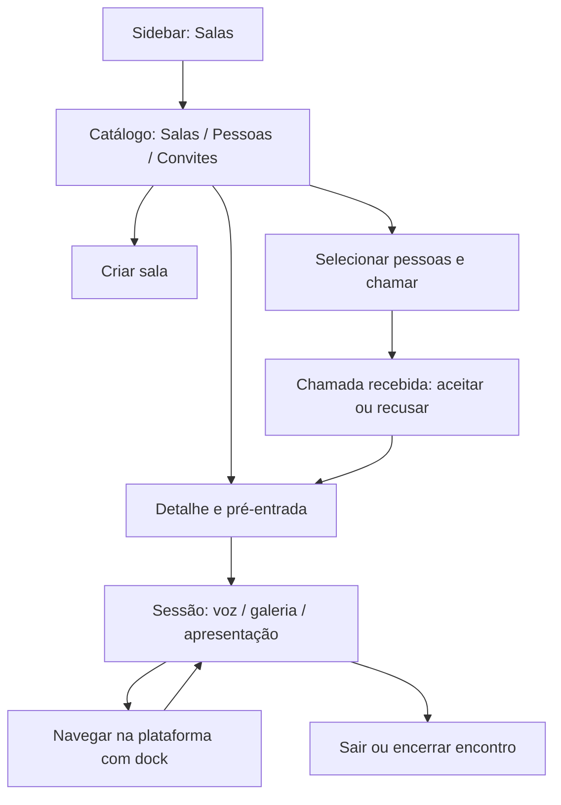

# Wireframes — Comunicação Convext

Complemento da [spec técnica](./comunicacao-tempo-real.md). Baixa fidelidade: caixas representam regiões e hierarquia, não aparência final. Textos, pessoas, salas e contagens nos exemplos são ilustrativos. Manter o shell e os tokens atuais da Convext; não reproduzir barra de servidores, árvore de canais ou identidade do Discord.

## 1. Mapa de navegação



Um único item Salas reúne salas persistentes, diretório mínimo de colegas e convites. Chamadas diretas também chegam pela camada global enquanto o usuário está em outra página. Nenhuma tela de catálogo captura mic/câmera.

## 2. W01 — Catálogo de salas, desktop

```text
┌───────────────────┬─────────────────────────────────────────────────┐
│ CONVEXT           │ Área Convext                                    │
│                   │ Salas                                           │
│ Dashboard         ├─────────────────────────────────────────────────┤
│ Demandas          │ Converse com a equipe          [+ Criar sala]   │
│ Salas  ← ativo    │ [Salas] [Pessoas] [Convites · 2]                 │
│ ...por role       │ [Buscar sala________________] [Todas ▾]         │
│                   │                                                 │
│                   │ [Geral]                     [Revisão criativa]  │
│                   │ Aberta à equipe             Privada             │
│                   │ 3 participantes             2 participantes     │
│                   │ (avatares)                  (avatares)          │
│                   │ [Ver e entrar]              [Ver e entrar]      │
│                   │                                                 │
│                   │ [Planejamento]                                  │
│                   │ Aberta · Vazia              [Ver e entrar]      │
│                   │                                                 │
│ Perfil/status     │                                                 │
└───────────────────┴─────────────────────────────────────────────────┘
```

Shell existente: sidebar 288px em `lg`, header sticky e padding 16/24/32px. Catálogo em 1–3 colunas conforme área útil. Card contém título, acesso, contagem, até quatro avatares e uma ação principal. Menu de gestão só aparece com permissão. Nenhuma sala privada inacessível entra na busca ou no filtro.

Vazio global: “Ainda não há salas” + Criar sala. Busca vazia: “Nenhuma sala encontrada” + Limpar busca. Loading: Skeleton com estrutura estável. Erro: mensagem inline + Tentar novamente. Sala bloqueada: “Novas entradas bloqueadas”, com ação desativada e explicação.

## 3. W02 — Criar/editar sala e escolher pessoas

```text
┌─────────────────────────────────────────────────────┐
│ Criar sala                                      [×] │
│ Nome                                                │
│ [_______________________________________________]   │
│ Descrição opcional                                  │
│ [_______________________________________________]   │
│ Acesso                                              │
│ (•) Aberta à equipe   ( ) Privada por convite         │
│                                                     │
│ Convidar pessoas [se privada]                        │
│ [Buscar nome________________________]               │
│ [✓] Pessoa A         [ ] Pessoa B                    │
│ Selecionados: Pessoa A [remover]                     │
│                              [Cancelar] [Criar]     │
└─────────────────────────────────────────────────────┘
```

Dialog no desktop, Sheet de altura disponível no celular. Erros por campo; submit desabilitado durante envio; seleção preservada em falha. Criar não entra automaticamente. Propriedade, bloqueio, transferência e arquivamento ficam em Gestão da sala, acessada pelo menu, sem misturar criação com controles da chamada.

Aba Pessoas reutiliza o seletor com nome/avatar e disponibilidade manual, além de indicador separado Em chamada. CTA “Chamar 3 pessoas”. Não expor e-mails/cargos administrativos apenas para localizar colegas. Convites pendentes mostram remetente, nome da sala permitida, validade e Aceitar/Recusar.

## 4. W03 — Pré-entrada

```text
┌───────────────────┬─────────────────────────────────────────────────┐
│ Sidebar Convext   │ Salas / Revisão criativa                         │
│                   ├─────────────────────────────────────────────────┤
│                   │ [← Voltar]        Privada · 2 pessoas na sala    │
│                   │                                                 │
│                   │ ┌────────────────────┐  Antes de entrar         │
│                   │ │                    │  Microfone [Dispositivo▾]│
│                   │ │ Avatar / preview   │  [Testar microfone]      │
│                   │ │ local da câmera    │  Nível [─────          ] │
│                   │ │                    │  Câmera [Dispositivo ▾] │
│                   │ └────────────────────┘  [Ativar câmera]         │
│                   │ Mic desligado · Câmera desligada                │
│                   │ [Entrar só para ouvir]        [Entrar na sala]  │
└───────────────────┴─────────────────────────────────────────────────┘
```

“Entrar” usa escolhas explícitas atuais; “Entrar só para ouvir” força ambas desligadas. Preview é local e não publica. Captura iniciada para teste deve ser encerrada ao cancelar ou desligar. Permissão negada mostra orientação junto ao dispositivo; não bloqueia escuta. Revalidar sala cheia/bloqueada/convite antes do ingresso. Se a pessoa já estiver conectada nessa sala, substituir pré-entrada por “Voltar à chamada”.

## 5. W04 — Sala somente de voz

```text
┌───────────────────┬─────────────────────────────────────────────────┐
│ Sidebar Convext   │ Revisão criativa           [Pessoas 4] [⋯]      │
│                   ├─────────────────────────────────────────────────┤
│                   │ Conectado · 04:32            [Convidar]          │
│                   │                                                 │
│                   │    ┌──────────────┐       ┌──────────────┐      │
│                   │    │   Avatar A   │       │   Avatar B   │      │
│                   │    │ Nome        │       │ Nome         │      │
│                   │    │ Falando     │       │ Mic desligado│      │
│                   │    └──────────────┘       └──────────────┘      │
│                   │    ┌──────────────┐       ┌──────────────┐      │
│                   │    │ Avatar C     │       │ Você          │      │
│                   │    │ Ouvindo      │       │ Mic desligado │      │
│                   │    └──────────────┘       └──────────────┘      │
│                   │                                                 │
│                   ├─────────────────────────────────────────────────┤
│                   │ [Mic ▾] [Câmera ▾] [Apresentar] [Áudio ▾] [Sair]│
└───────────────────┴─────────────────────────────────────────────────┘
```

Tiles mantêm posição estável; não reordenar a cada palavra. Fala ativa muda contorno e indicador sem pulsação excessiva. Avatar, nome, mute e restrição de moderação permanecem legíveis. Barra ocupa largura do conteúdo e não cobre sidebar. “Sair” é destrutivo e visualmente separado. “Encerrar para todos” fica no menu de moderadores, com confirmação.

Botão Áudio controla escuta local (desativar escuta também desativa mic para evitar falar sem ouvir; reativar escuta mantém mic desligado). Dropdown inclui seleção de saída quando suportada e link para configurações. Volume por participante fica no menu do tile e afeta só o receptor.

## 6. W05 — Vídeo em grupo e painel de pessoas

```text
┌───────────────────┬──────────────────────────────────┬──────────────┐
│ Sidebar Convext   │ Revisão · 4 pessoas   [Grade ▾]  │ Pessoas [×]  │
│                   ├──────────────────────────────────┤              │
│                   │ ┌──────────────┬───────────────┐ │ Você · dono  │
│                   │ │ Câmera A     │ Câmera B      │ │ A · falando  │
│                   │ │ Nome / mute  │ Nome / mute   │ │ B · mic off  │
│                   │ ├──────────────┼───────────────┤ │ C · ouvindo  │
│                   │ │ Avatar C     │ Sua câmera    │ │              │
│                   │ │ Nome         │ Você          │ │ [Convidar]   │
│                   │ └──────────────┴───────────────┘ │              │
│                   ├──────────────────────────────────┴──────────────┤
│                   │ [Mic ▾] [Câmera ▾] [Apresentar] [Áudio ▾] [Sair] │
└───────────────────┴─────────────────────────────────────────────────┘
```

No desktop largo, painel opcional de 280–320px; abaixo de 1280px vira Sheet para não esmagar vídeo. Galeria usa 1–3 colunas e proporção 16:9, com paginação para mais de 9 tiles visíveis. Câmeras fora da página podem reduzir/pausar assinatura; áudio continua. Para 1:1, remoto em destaque e preview próprio menor; ambos continuam acessíveis.

Menu do tile: Fixar para mim, volume local, ações de moderação autorizadas. Tile sempre mantém identidade quando câmera falha ou é desligada. Nenhum controle essencial depende de hover.

## 7. W06 — Apresentação

```text
┌───────────────────┬─────────────────────────────────────────────────┐
│ Sidebar Convext   │ A está apresentando    [Ajustar] [Tela cheia]    │
│                   ├─────────────────────────────────────────────────┤
│                   │ ┌─────────────────────────────────────────────┐ │
│                   │ │                                             │ │
│                   │ │       TELA / JANELA / ABA COMPARTILHADA      │ │
│                   │ │       conteúdo inteiro, sem recorte         │ │
│                   │ │                                             │ │
│                   │ └─────────────────────────────────────────────┘ │
│                   │ [Você] [A] [B] [C]       faixa de participantes │
│                   │ Sua tela está sendo compartilhada [Parar]       │
│                   │ Áudio da apresentação: ativo [Silenciar tela]   │
│                   ├─────────────────────────────────────────────────┤
│                   │ [Mic ▾] [Câmera ▾] [Parar apresentação]   [Sair] │
└───────────────────┴─────────────────────────────────────────────────┘
```

Aviso “Sua tela...” e controle de áudio da tela aparecem apenas ao apresentador e só se existe track de áudio. Receptores veem nome do apresentador e podem ajustar a visualização local. Usar contain para apresentação, evitando cortar texto. Fullscreen é modo de visualização separado da conexão; Escape restaura a tela anterior.

Botão Apresentar dispara seletor do navegador. Enquanto outra pessoa apresenta, informar “A já está apresentando”; moderador pode interromper antes de iniciar a própria. Quando uma apresentação começa e não há fixação manual, ela vira destaque. Quem fixou outra fonte recebe aviso discreto para assistir. Ao terminar, voltar ao modo anterior disponível.

## 8. W07 — Chamada recebida e chamada em espera

```text
Página atual continua visível
                          ┌────────────────────────────────────────┐
                          │ [Avatar] A está chamando                │
                          │ Chamada em grupo · A, B e você          │
                          │ [Recusar]              [Aceitar]        │
                          └────────────────────────────────────────┘

Depois de aceitar → pré-entrada → sessão

Para quem iniciou:
┌───────────────────────────────────────────────────────────────────┐
│ Chamando A e B...                                                  │
│ A: aguardando resposta       B: recusou                            │
│ Seu microfone está desligado                           [Cancelar]  │
└───────────────────────────────────────────────────────────────────┘
```

Card recebido fica na camada global, sem roubar foco durante digitação. Ação acessível via teclado, anúncio moderado e som opcional. Fecha ao expirar/cancelar/aceitar em outro dispositivo. Não empilhar toques: no máximo um convite em destaque; demais na inbox. Em outra chamada: “Você está em X” + “Sair e atender”, com confirmação antes de trocar.

## 9. W08 — Dock durante o trabalho

```text
┌───────────────────┬─────────────────────────────────────────────────┐
│ Sidebar Convext   │ Demandas                                        │
│                   ├─────────────────────────────────────────────────┤
│                   │ Quadro e filtros existentes                     │
│                   │                                                 │
│                   │                                                 │
│                   │                                                 │
│                   ├─────────────────────────────────────────────────┤
│                   │ Revisão · 08:41 · 4 pessoas                      │
│                   │ [Mic] [Câmera] [Parar tela*] [Abrir] [Sair]      │
└───────────────────┴─────────────────────────────────────────────────┘
```

`*` aparece quando a própria tela está ativa. Dock participa do cálculo de padding inferior e safe area; nunca cobre último card, modal, toast ou ação flutuante existente. Reposicionar FAB da Convext acima dele. Em `/app/salas/...` ou `/app/chamadas/...` com palco ativo, usar barra completa e ocultar dock; nunca duplicar controles/áudio. Duração, estado e mute são do mesmo provider.

## 10. W09 — Celular

```text
┌───────────────────────────────┐
│ [☰] Salas               [+]  │
│ [Salas] [Pessoas] [Convites]   │
│ [Buscar____________________]  │
│ Geral · Aberta                │
│ 3 pessoas       [Ver e entrar]│
│ Revisão · Privada             │
│ 2 pessoas       [Ver e entrar]│
└───────────────────────────────┘

┌───────────────────────────────┐
│ [←] Revisão    [Pessoas 4][⋯] │
│ Conectado · 08:41             │
│ ┌───────────────────────────┐ │
│ │ Tela compartilhada        │ │
│ │ ou participante em foco   │ │
│ └───────────────────────────┘ │
│ [Você] [A] [B] [C] →          │
│                               │
│ [Mic] [Câmera] [Mais] [Sair]  │
│ safe-area                     │
└───────────────────────────────┘
```

Até 767px: uma coluna no catálogo; galeria de até 4 tiles por página; apresentação/foco ocupa largura; Pessoas e Configurações abrem Sheet. Tablet: duas colunas quando couber; sidebar mantém breakpoint atual `lg`. Não forçar rotação. No mobile, Mais contém dispositivos e apresentação quando suportada; se estiver apresentando, Parar fica sempre visível, mesmo exigindo segunda linha. Barra compacta em outras páginas permite mic, abrir e sair.

Usar altura dinâmica (`dvh`) e safe areas; conteúdo rola sem esconder controles. Teclado virtual não pode esconder submit em convites. Validar 360px, 768px, 1280px e 1440px, incluindo zoom 200%.

## 11. W10 — Estados transversais

| Estado | Onde e como aparece | Ação |
|---|---|---|
| Conectando | Região do palco + texto; controles de mídia pendentes | Cancelar |
| Reconectando | Faixa persistente, mantém tiles com estado de indisponibilidade | Sair; após timeout, Reconectar |
| Som bloqueado pelo navegador | Banner acima dos controles | Ativar áudio da chamada |
| Mic negado | Inline no pré-entrada ou configurações | Instruções; Continuar ouvindo |
| Câmera em uso/ausente | Tile vira avatar e explica falha | Selecionar outra / Tentar novamente |
| Sala cheia | Pré-entrada preserva escolhas | Tentar novamente / Voltar |
| Sala bloqueada | Catálogo/detalhe com explicação | Voltar |
| Apresentação recusada/cancelada | Mensagem discreta; palco anterior permanece | Tentar novamente se quiser |
| Silenciado pelo moderador | Ícone + texto junto ao mic | Aguardar permissão; nunca reativar sozinho |
| Aplicando moderação | Status de ação pendente no participante | Retry controlado pelo backend |
| Removido / sessão encerrada | Tela final, tracks locais encerradas | Voltar para Salas |
| Serviço indisponível | Erro acionável, sem estado falso de conectado | Tentar novamente / Sair |
| Outra sessão ativa | Dialog com nome permitido e consequência | Manter atual / Sair e entrar |

## 12. Contrato de interação e fidelidade

Todos os botões têm texto acessível; toggles expõem estado; o foco volta ao acionador ao fechar Dialog/Sheet. Escape fecha overlay, não desliga a chamada. Preferir controles sempre visíveis a auto-hide. Atalhos opcionais só com documentação e sem capturar digitação em inputs; não são dependência da v1.

Validar os fluxos W01→W03→W04→W05→W06→W08, W02→convite→W03 e W07→W03 em desktop e mobile. Estas estruturas podem ser implementadas com os componentes existentes da Convext. As dimensões de painéis são orientações responsivas; identidade, contraste, tipografia, raios e estilos de botões vêm do design system atual.
